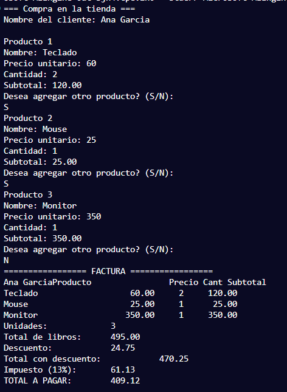
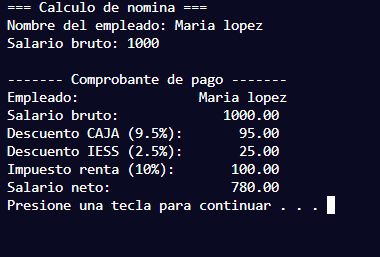
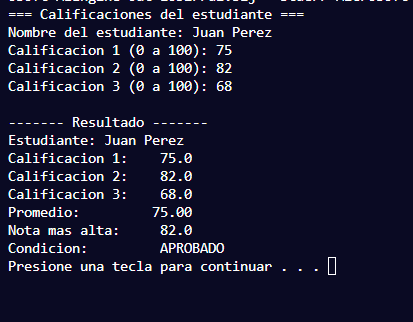

# AC2 · Mi primera aplicación en C

**Estudiante:** (nombre completo)  
**Fecha:** 20/10/2026  
**Módulo:** CSTI12010 Diseño de algoritmos · UA2

## Problema 1 · Nómina (AC2_P1_Nomina.c)

| Datos de entrada | Proceso | Datos de salida | Limitaciones |
|Un nombre que no sea vacio y un salario bruto|Entra un nombre el cual es verificado que no se vacio y un numero que tambien es verificado que sea mayor a 1 si salario bruto es mayor a 800 entonces tiene renta sino renta es 0 y se calculan las deducciones|El nombre, salario bruto, descuento de CAJA, IESS y RENTA por ultimo el salario neto|Solo numeros enteros positivos y nombre no vacios|
|  |  |  |  |

**Ejecución con los datos del ejemplo:**

## Problema 2 · Calificaciones (AC2_P2_Calificaciones.c)

| Datos de entrada | Proceso | Datos de salida | Limitaciones |
|Un nombre (Puede ser vacio e igual no da error) y tres calificaciones|Se escribe el nombre y luego se entra en un ciclo for que tiene un ciclo do while para verificar las calificaciones que entran solo se admiten de 0 a 100 luego de se compara la nota actual con una nota que a sido mas alto registrada y se compararan si es menos alto que la actual se cambia a esa fuera de los ciclos se saca la condicion|El nombre del estudiante, las tres notas, el promedio, la nota mas alta y la condicion|Solo numeros de entre 0 y 100 y el nombre puede ser vacio|
|  |  |  |  |

**Ejecución con los datos del ejemplo:**

## Problema 3 · Compras (AC2_P3_Compras.c)

| Datos de entrada | Proceso | Datos de salida | Limitaciones |
|Nombre, el producto , el precio unitario y la cantidad|Se pone un nombre entra en un ciclo while que tiene centinela i y acaba si se pone la letra N o llega al maximo de productos, dentro de este se pide el nombre de cada producto el precio y la cantidad despues se le pregunta al cliente si quiere seguir y si vuelve a pedir desde el nombre del producto|El nombre, La lista de productos con nombre, precio, cantidad y subtotal luego Productos registrados, subtotal, descuento, total con descuento, impuesto y total a pagar|El nombre puede ser vacio cliente y producto, el precio y cantidad tienen que ser mayores a 1 positivo, solo se acepta S y s o N y n cuando se le pregunata al cliente si quiere continuar|
|  |  |  |  |

**Ejecución con los datos del ejemplo:**

## Conclusión

(Qué aprendí y qué fue lo más difícil de pasar de PSeInt a C.)
